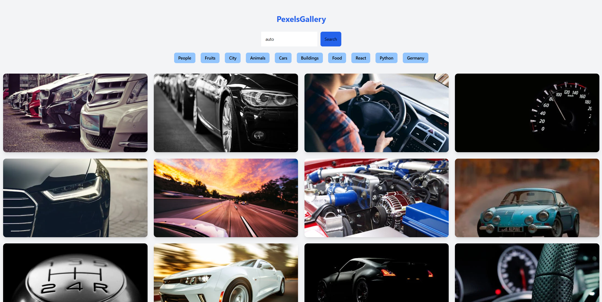
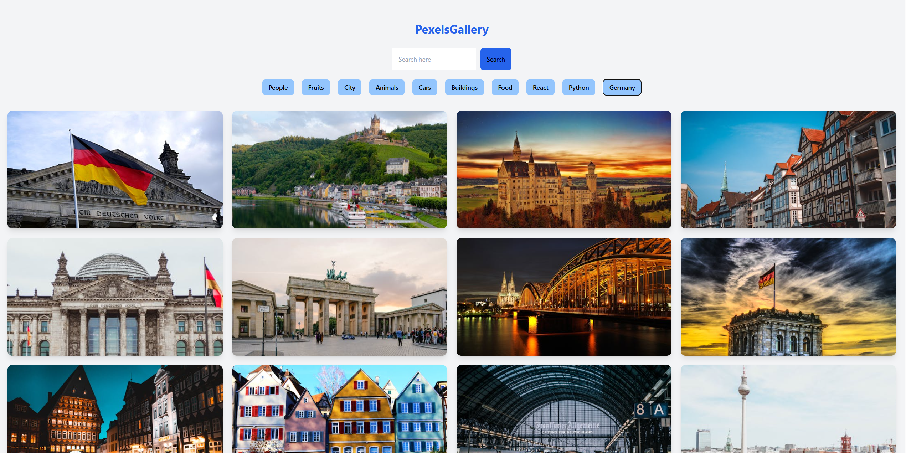
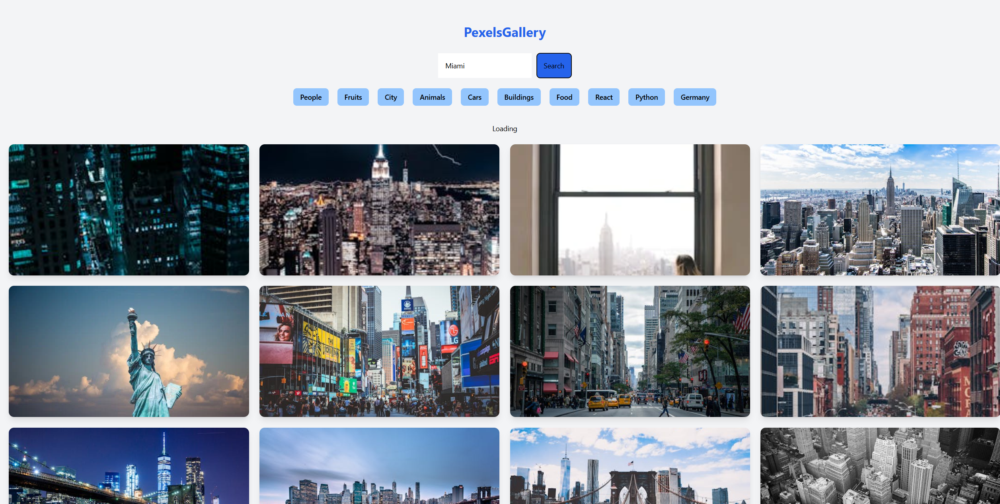

# 🖼️ Pexels Gallery - Image Search Application

A modern, responsive image gallery application built with React and the Pexels API. Search millions of high-quality photos with an intuitive interface and smooth user experience.



## 🚀 Live Demo

**[View Live Demo](https://martin-frei.github.io/react-pexels-gallery)**

## ✨ Features

- 🔍 **Smart Search** - Search through millions of high-quality images
- 🎯 **Quick Filters** - Pre-defined category buttons for instant browsing
- 📱 **Responsive Design** - Optimized for all screen sizes
- ⚡ **Fast Loading** - Efficient API integration with loading states
- 🎨 **Modern UI** - Clean interface with Tailwind CSS
- 🖱️ **Smooth Interactions** - Hover effects and transitions

## 🛠️ Tech Stack

- **React** (Hooks: useState, useEffect, useRef)
- **Tailwind CSS** - Utility-first styling
- **Pexels API** - High-quality image source
- **Async/Await** - Modern JavaScript patterns

## 📸 Screenshots

### Main Gallery View


### Search Functionality


### Loading State


## 🎯 Key Concepts Demonstrated

- ✅ **API Integration** - RESTful API calls with proper authentication
- ✅ **State Management** - React Hooks (useState, useEffect, useRef)
- ✅ **Async Operations** - Fetch API with error handling
- ✅ **Form Handling** - Search input with validation
- ✅ **Dynamic Rendering** - Category filters with map function
- ✅ **Responsive Grid** - CSS Grid with Tailwind
- ✅ **Loading States** - User feedback during data fetching

## 🚀 Getting Started

### Prerequisites

- Node.js (v14 or higher)
- npm or yarn

### Installation

1. **Clone the repository**
   ```bash
   git clone https://github.com/Martin-Frei/react-pexels-gallery.git
   cd react-pexels-gallery
   ```

2. **Install dependencies**
   ```bash
   npm install
   ```

3. **Start the development server**
   ```bash
   npm start
   ```

4. **Open your browser**
   ```
   http://localhost:3000
   ```

## 🔧 Configuration

The app uses the Pexels API. For production use, consider:

- Implementing a backend proxy to secure the API key
- Using environment variables for configuration
- Adding rate limiting to prevent API quota exhaustion

**Note:** In a production environment, API keys should be stored securely using:
- Backend proxy server (Node.js/Django)
- Serverless functions (Netlify/Vercel)
- Environment variables with server-side rendering

## 📦 Project Structure

```
react-pexels-gallery/
├── public/
│   ├── index.html
│   └── favicon.ico
├── src/
│   ├── App.js              # Main app component
│   ├── PexelsGallery.jsx   # Gallery component with API logic
│   ├── App.css             # Styling
│   └── index.js            # Entry point
├── screenshot/             # App screenshots
├── package.json
└── README.md
```

## 🎨 Features in Detail

### Search Functionality
- Real-time search with debouncing
- Input validation
- Clear search results

### Category Filters
Pre-defined categories for quick browsing:
- People, Fruits, City, Animals
- Cars, Buildings, Food
- React, Python, Germany

### Image Grid
- Responsive 4-column grid layout
- Hover scale effects
- Optimized image loading (medium resolution)
- Clean card design with shadows

## 🔄 API Integration

Using the [Pexels API](https://www.pexels.com/api/) for:
- Image search functionality
- High-quality stock photos
- 40 images per request
- Authorization via API key

## 🌱 Future Enhancements

- [ ] Infinite scroll / pagination
- [ ] Image modal/lightbox view
- [ ] Favorites/liked images (localStorage)
- [ ] Download functionality
- [ ] Advanced filters (color, orientation, size)
- [ ] Search history
- [ ] Dark mode toggle
- [ ] Backend proxy for API key security

## 📚 What I Learned

This project helped me practice:
- Working with external REST APIs
- Managing async operations in React
- Implementing search and filter functionality
- Creating responsive layouts with Tailwind CSS
- Handling loading and error states
- Using React refs for form controls

## 🤝 Contributing

This is a portfolio project, but suggestions and feedback are welcome!

## 📄 License

This project is open source and available under the [MIT License](LICENSE).

## 👨‍💻 Author

**Martin Freimuth**
- GitHub: [@Martin-Frei](https://github.com/Martin-Frei)
- LinkedIn: [martin-freimuth](https://www.linkedin.com/in/martin-freimuth-089249359/)
- Email: mat.frei@gmx.de

## 🙏 Acknowledgments

- [Pexels](https://www.pexels.com/) for providing the free API
- [Tailwind CSS](https://tailwindcss.com/) for the utility-first CSS framework
- [React](https://reactjs.org/) for the awesome JavaScript library

---

**⭐ If you found this project helpful, please consider giving it a star!**

*Built with ❤️ using React and Tailwind CSS*